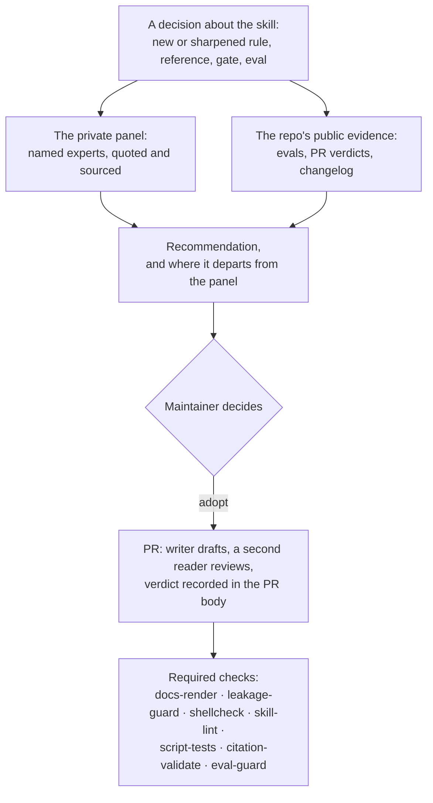

# Expert panel — senior-engineering-partner

Last updated: 2026-11-05 02:59 PM CST

> [!NOTE]
> **The rule.** Every decision about this skill (a new or sharpened rule, a reference, a gate, a change to the eval harness) opens with what the skill's expert panel says, then the recommendation and where it departs from them. The maintainer decides. The panel advises; it never outranks the consent gate in [`references/skill-self-improvement.md`](../references/skill-self-improvement.md).

## Contents

- [What an expert panel is](#what-an-expert-panel-is)
- [Where the panel lives](#where-the-panel-lives)
- [Public evidence a decision can cite](#public-evidence-a-decision-can-cite)
- [How a decision flows](#how-a-decision-flows)

## What an expert panel is

A panel is a list of named experts in the skill's domains: code review, testing, debugging, security, operability, documentation and the direction of coding agents. For each expert it records a principle, quoted as written and linked to its source; how that principle bears on the skill; and where the skill departs from it, with the reason. A principle that cannot be sourced is marked as unverified and is never stated as fact in a PR body or a proposal.

[↑ Back to contents](#contents)

## Where the panel lives

The maintainer keeps this skill's panel privately, outside the repo. The repo publishes the rule, not the roster.

A contributor or forker who adopts the rule keeps their own panel wherever their environment profile says. The profile is `references/my-environment.md`, which is `.gitignore`d and never committed; the repo ships only [`references/my-environment.template.md`](../references/my-environment.template.md). A panel stays out of the public tree for the same reason the profile does: the universal core stays universal.

[↑ Back to contents](#contents)

## Public evidence a decision can cite

Alongside the panel, a decision cites what the repo already records:

| Evidence | Where | What it tells a decision |
|---|---|---|
| Eval scenarios | `evals/scenarios/`, one JSON scenario per real miss | Whether a proposed rule is already guarded, and which misses recur |
| Recorded baselines | `evals/baselines/`, bare-model and with-skill sweeps | What the skill closes, per scenario, and where it does not help |
| Review verdicts | The body of every merged PR, per [`CLAUDE.md`](../CLAUDE.md) and [`CONTRIBUTING.md`](../CONTRIBUTING.md) | What the second reader caught |
| The changelog | [`CHANGELOG.md`](../CHANGELOG.md), with the origin story behind each rule | Why a rule exists, and what it cost before it did |
| The loop's procedure | [`references/skill-self-improvement.md`](../references/skill-self-improvement.md) | The two-instance bar and the consent gate a change must clear |

[↑ Back to contents](#contents)

## How a decision flows

[↑ Back to contents](#contents)
