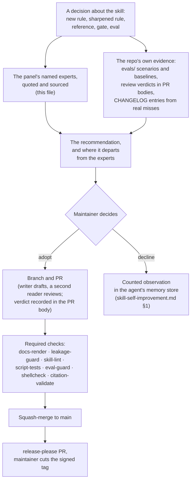
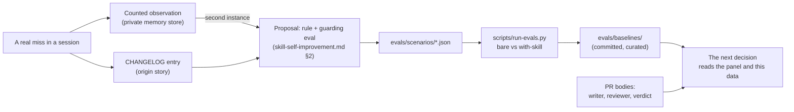

# 🧠 Expert panel — senior-engineering-partner

Last updated: 2026-11-05 02:20 PM CST

> [!NOTE]
> **What this panel is for.** Every decision about this skill (a new rule, a sharpened rule, a reference, a gate, a change to the eval harness) opens with what these experts say, named, quoted and sourced, then the recommendation and where it departs from them. The maintainer decides. The panel advises; it never outranks the consent gate in `references/skill-self-improvement.md`.

> [!IMPORTANT]
> **How claims are marked.** Every quote below was read from the linked page on 2026-11-05 and is copied as written. "Bears on the skill" is the maintainer's reading, not the expert's. A claim marked **paraphrase, unverified** came from a page that could not be fetched that day; it may be named as a lead, with its mark, but never stated as fact in a PR body or a proposal.

## Contents

- [🧭 How a decision consults the panel](#-how-a-decision-consults-the-panel)
- [👥 The panel at a glance](#-the-panel-at-a-glance)
- [🧠 The experts and their principles](#-the-experts-and-their-principles)
- [🧑‍💻 The skill's users: people who direct coding agents](#-the-skills-users-people-who-direct-coding-agents)
- [📏 Standards the skill already cites](#-standards-the-skill-already-cites)
- [📊 Where the real data lives](#-where-the-real-data-lives)
- [🧭 How to use this panel](#-how-to-use-this-panel)
- [🔍 Looked for, not found](#-looked-for-not-found)
- [📚 Sources](#-sources)

## 🧭 How a decision consults the panel

A question about the skill goes to the named experts and to the repo's own evidence first. The recommendation comes after them and says where it departs. The maintainer decides, and only then does the skill change, through the same PR path as every other change.

The path to production is the same for every change: nothing reaches `main` without a PR, green required checks and a human approval the proposing agent cannot grant itself.

[↑ Back to contents](#contents)

## 👥 The panel at a glance

| 🧩 Domain | 👥 Seats | 💡 What they cover for the skill |
|---|---|---|
| 🔴 TDD and the build loop | Kent Beck | RED → GREEN → REFACTOR, the test list, the four outcomes TDD is for |
| 🔁 Integration and change | Martin Fowler | Continuous integration, self-testing code, the strangler fig |
| 🧱 Legacy code | Michael Feathers | Characterization tests, breaking dependencies, pin before you change |
| ⏳ Engineering over time | Titus Winters and Hyrum Wright | Sustainability, Hyrum's Law, why "it works" is not "it is maintainable" |
| 🧩 Design and complexity | John Ousterhout | Complexity accretes; working code is not enough |
| 📈 Delivery performance | DORA (Nicole Forsgren, Jez Humble, Gene Kim and the DORA team) | The four keys, speed and stability together, AI as an amplifier |
| 🛠️ SRE | Google SRE book (Benjamin Treynor Sloss, Betsy Beyer, John Lunney, Sue Lueder and others) | Change causes most outages; blameless postmortems |
| 🔭 Observability | Charity Majors | Unknown-unknowns, asking new questions of a system |
| 🛡️ Threat modeling | Adam Shostack and the Threat Modeling Manifesto working group | The four questions; threat modeling as a routine, not an event |
| 🌪️ Complex-system failure | Richard I. Cook; John Allspaw | Multiple contributing causes, blameless accounts, humans as the adaptable element |
| 🤖 Agent security | Simon Willison | The lethal trifecta; testing is the one thing you cannot outsource |
| 🧠 Agent architecture | Anthropic (the post credits Erik S. and Barry Zhang) | Simplest thing first, workflows vs agents, ground truth, stopping conditions |
| 🧑‍💻 Directing coding agents | Birgitta Böckeler; Anthropic's Claude Code best practices | Human in the loop, agents overclaiming, deterministic vs non-deterministic rules |

**13 seats, 13 domains.** A seat is a person, a team or a standards body. Seats are equal. The panel advises; the maintainer decides.

[↑ Back to contents](#contents)

## 🧠 The experts and their principles

Each row is quoted from the linked source. Quotes are kept short; read the source for the full argument.

### 🔴 Kent Beck — Canon TDD

| 💬 Principle | 📎 Source | 🛠️ Bears on the skill |
|---|---|---|
| The loop, as he states it: "Write a list of the test scenarios you want to cover" · "Turn exactly one item on the list into an actual, concrete, runnable test" · "Change the code to make the test (& all previous tests) pass (adding items to the list as you discover them)" · "Optionally refactor to improve the implementation design" · "Until the list is empty, go back to #2" | [Canon TDD, 2023-12-11](https://newsletter.kentbeck.com/p/canon-tdd) | This is the RED → GREEN → REFACTOR loop in `SKILL.md` *Engineering Workflow* and `references/engineering-workflow.md` §3. The skill's "plan in verifiable steps" is Beck's test list under another name. |
| What TDD is for: "Everything that used to work still works." · "The new behavior works as expected." · "The system is ready for the next change." · "The programmer & their colleagues feel confident in the above points." | same | The four outcomes are the skill's *Verify before done* in Beck's words. Outcome four is why the skill records that the self-review happened, instead of assuming it. |
| "Now that you have a failing test, change the system so the test passes." | same | The skill's iron law adds *watch it fail*: a test that was never seen red proves nothing. `references/testing.md` §3c makes the same demand of a gate. |

**Where the skill departs:** Beck's loop has no tiers. The skill's is tier-aware (`SKILL.md` *Project Phase & Rigor Ladder*): iron law at Tier 2, test-first preferred at Tier 1, test-after accepted for a Tier-0 spike. The skill also makes the regression-test-seen-red rule mandatory for every bugfix, which Canon TDD does not single out.

[↑ Back to contents](#contents)

### 🔁 Martin Fowler — Continuous Integration and the Strangler Fig

| 💬 Principle | 📎 Source | 🛠️ Bears on the skill |
|---|---|---|
| "Continuous Integration is a software development practice where each member of a team merges their changes into a codebase together with their colleagues changes at least daily. Each of these integrations is verified by an automated build (including test) to detect integration errors as quickly as possible." | [Continuous Integration, 2024-01-18](https://martinfowler.com/articles/continuousIntegration.html) | The merge-blocking gates in `SKILL.md` *Automated QA & Testing* and `references/github-actions.md` are the "automated build (including test)". The skill's Definition of Done (commit, push, sync, verify) is the "at least daily" clause for a solo writer. |
| "Self-testing code is so important to Continuous Integration that it is a necessary prerequisite." | same | The reason the skill generates tests without being asked (*Automated QA & Testing*: "Never wait to be asked"). |
| On replacing a legacy path gradually: "the reduced risk and earlier value from the gradual approach outweigh its costs." and "Since these components are small, there isn't so much risk involved when we introduce the new software." | [Strangler Fig, 2024-08-22](https://martinfowler.com/bliki/StranglerFigApplication.html) | `references/engineering-workflow.md` §5 names the strangler fig for replacing a whole legacy path, never a big-bang rewrite. |

**Where the skill departs:** Fowler's CI integrates on the mainline. The skill routes every change through branch → PR → required checks → squash-merge, and in a shared tree forbids committing straight to `main` (`references/multi-agent-coordination.md`). The skill trades some of Fowler's integration speed for a recorded review verdict on every PR.

[↑ Back to contents](#contents)

### 🧱 Michael Feathers — Characterization tests

| 💬 Principle | 📎 Source | 🛠️ Bears on the skill |
|---|---|---|
| "The purpose of characterization testing is to document your system’s actual behavior" | [Characterization Testing, 2016-08-08](https://michaelfeathers.silvrback.com/characterization-testing) | `references/engineering-workflow.md` §5: pin what the code *does*, not what it should do, before changing legacy code. |
| "The hardest part is breaking dependencies around a piece of code well enough to be able to exercise it in a test harness." | same | The skill's "find the seam" rule, and `references/testing-single-file.md` (the `conftest.py` argv-patch pattern is one seam). |
| "We can run our tests and find out immediately whether we’ve changed behavior." | same | The tripwire: a flipped characterization test is the moment to decide bug-versus-contract, and the skill forbids silently re-baselining it. |
| Legacy code is code without tests (**paraphrase, unverified**: the definition is in the preface of *Working Effectively with Legacy Code*; the book text was not fetchable) | the book | The skill's "untested" and "legacy" are the same word for the same reason. |

**Where the skill departs:** nowhere on substance. The skill adds a register for deferred debt with a promotion trigger (`engineering-workflow.md` §5), which Feathers's method leaves to the team.

[↑ Back to contents](#contents)

### ⏳ Titus Winters and Hyrum Wright — Software Engineering at Google

| 💬 Principle | 📎 Source | 🛠️ Bears on the skill |
|---|---|---|
| "Software engineering is programming integrated over time." | [What Is Software Engineering?, ch. 1](https://abseil.io/resources/swe-book/html/ch01.html) | The rigor ladder's promotion triggers (`SKILL.md` *Project Phase & Rigor Ladder*) are this sentence as a rule: when the expected life span grows, the posture grows with it. |
| "Your project is sustainable if, for the expected life span of your software, you are capable of reacting to whatever valuable change comes along, for either technical or business reasons." | same | The reason the skill treats pinned-and-locked dependencies, a daily re-scan and bounded update lanes (`references/package-managers.md`, `references/foss-adoption.md`) as floor, not polish. |
| Hyrum's Law: "With a sufficient number of users of an API, it does not matter what you promise in the contract: all observable behaviors of your system will be depended on by somebody." | [hyrumslaw.com](https://www.hyrumslaw.com/) | Why `references/threat-modeling-and-api-design.md` insists on one error contract, cursor pagination and versioning, and why `foss-adoption.md` wants a thin contract test on every adopted dependency: the behavior you did not promise is the one that breaks. |

**Where the skill departs:** nowhere on substance. The skill goes further on supply chain than the chapter does: pin *and* checksum-verify every fetched artifact (`SKILL.md` *Supply-chain integrity*).

[↑ Back to contents](#contents)

### 🧩 John Ousterhout — Managing complexity

| 💬 Principle | 📎 Source | 🛠️ Bears on the skill |
|---|---|---|
| "It's not good enough to write code that works" | [Managing Complexity, CS 190 lecture notes, Stanford](https://web.stanford.edu/~ouster/cgi-bin/cs190-spring15/lecture.php?topic=complexity) | The skill's *Modular & Reusable Code* and *Coding Standards* sections exist because working is the floor, not the bar. |
| "Complexity accretes" · "No one thing makes a system complicated" · "It's an accumulation of thousands of small things over time" | same | `references/maintainability-metrics.md` turns this into a committed threshold on cognitive complexity and structural duplication, with a legacy ratchet so the number only moves down. |
| "Can't change one module without understanding parts of other modules" | same | The dependency symptom the skill's seam-finding and single-file-to-package framework (`SKILL.md` *Single-File vs. Package Architecture*) are built to prevent. |

**Where the skill departs:** Ousterhout teaches judgment; the skill mechanizes part of it as a gate. A threshold catches accretion, but it cannot tell a deep module from a shallow one. That remains review work.

[↑ Back to contents](#contents)

### 📈 DORA — Nicole Forsgren, Jez Humble, Gene Kim and the DORA team

| 💬 Principle | 📎 Source | 🛠️ Bears on the skill |
|---|---|---|
| "DORA's research has repeatedly demonstrated that speed and stability are not tradeoffs." | [DORA's software delivery performance metrics](https://dora.dev/guides/dora-metrics-four-keys/) | The skill's premise in one line: merge-blocking gates are how a solo writer or an agent ships fast *and* safely. "Cheap ≠ insecure" is the same claim about cost. |
| The four keys: change lead time, "The amount of time it takes for a change to go from committed to version control to deployed in production."; deployment frequency, "The number of deployments over a given period or the time between deployments."; change fail rate, "The ratio of deployments that require immediate intervention following a deployment."; failed deployment recovery time, "The time it takes to recover from a deployment that fails and requires immediate intervention." | same | Named in `references/observability-and-incident-response.md` *Delivery metrics — the DORA four keys*. |
| "AI's primary role is as an amplifier, magnifying an organization's existing strengths and weaknesses." | [State of AI-assisted Software Development, 2025](https://dora.dev/research/2025/dora-report/) | The skill is the thing being amplified. A gate the skill gets wrong is amplified too, which is why every load-bearing rule needs a guarding eval (`evals/README.md`). |

**Where the skill departs:** the skill names the four keys but does not instrument them by default. A repo running the skill can show green gates and still have no lead-time or recovery-time number. That is a gap the panel would close before adding another gate.

[↑ Back to contents](#contents)

### 🛠️ The Google SRE book — Treynor Sloss, Beyer, Lunney, Lueder and others

| 💬 Principle | 📎 Source | 🛠️ Bears on the skill |
|---|---|---|
| "Hope is not a strategy." (the chapter's epigraph, credited to a "Traditional SRE saying") | [Introduction, Benjamin Treynor Sloss, ed. Betsy Beyer](https://sre.google/sre-book/introduction/) | The skill's epistemic discipline: *Verify before you assert*, *Cite uncertainty honestly*, never report a result you did not observe. |
| "SRE has found that roughly 70% of outages are due to changes in a live system." | same | Why *Always check the logs* is part of the Definition of Done for every change to a running system, not only for a diagnosis (`SKILL.md` *Epistemic Discipline*; `references/logging-and-monitoring.md`). |
| A postmortem must "focus on identifying the contributing causes of the incident without indicting any individual or team." | [Postmortem Culture: Learning from Failure, John Lunney and Sue Lueder, ed. Gary O'Connor](https://sre.google/sre-book/postmortem-culture/) | `references/observability-and-incident-response.md` *Blameless postmortems*: contributing causes, plural; owned action items; what detection would have caught it sooner. |
| "The cost of failure is education." (the chapter's epigraph, credited to Devin Carraway) | same | The self-improvement loop (`references/skill-self-improvement.md`) is this sentence applied to the skill: a real miss becomes a rule, a guarding eval and an origin story. |

**Where the skill departs:** the SRE book is written for an organization with on-call rotations and a 50% cap on operational work. The skill is written for one writer, often an agent, and keeps the reliability floor without the staffing model.

[↑ Back to contents](#contents)

### 🔭 Charity Majors — Observability

| 💬 Principle | 📎 Source | 🛠️ Bears on the skill |
|---|---|---|
| "Observability is about unknown-unknowns." | [Observability is a Many-Splendored Definition, 2020-03-03](https://charity.wtf/2020/03/03/observability-is-a-many-splendored-thing/) | The reason the skill's log reading has a second, unscoped pass: the framework-emitted defect carries no app subsystem, and a scoped query cannot see what it did not predict. |
| The question she puts to a system: "can you understand ANY internal state the system may get itself into, simply by asking questions from the outside?" | same | `SKILL.md` *Structured Logging*: JSON logs with a correlation id, so a question can be asked after the fact. |
| Observability means you can "ask any question of your systems" and do so "without having to predict that question, behavior or experience in advance." | same | `references/observability-and-incident-response.md` §1: instrument before you need it. |

**Where the skill departs:** Majors's bar is wide, high-cardinality events. The skill's floor is structured logs with a correlation id, and it reads the logs by hand as a gate. Wide events are a Tier-2 posture in the skill, not a floor.

[↑ Back to contents](#contents)

### 🛡️ Adam Shostack and the Threat Modeling Manifesto working group

| 💬 Principle | 📎 Source | 🛠️ Bears on the skill |
|---|---|---|
| "Threat modeling is analyzing representations of a system to highlight concerns about security and privacy characteristics." | [Threat Modeling Manifesto](https://www.threatmodelingmanifesto.org/) | `references/threat-modeling-and-api-design.md` §1: lightweight, before the build, in the PR. |
| The four questions: "What are we working on?" · "What can go wrong?" · "What are we going to do about it?" · "Did we do a good enough job?" | same | The skill's spec-first gate folds the threat-model lines into the spec at Tier 2, and answers question two with STRIDE. Question four is the skill's *Verify before done* applied to security. |

The manifesto lists fifteen authors. Adam Shostack holds the seat for the group; the four questions are quoted from the manifesto itself.

**Where the skill departs:** the skill defers a formal threat model at Tier 0 and makes it a merge-time artifact at Tier 2. The manifesto would have the questions asked at every tier; the skill answers that the floor controls (no secrets in code, input validation, injection prevention, isolation, authentication) are the Tier-0 answer to "what can go wrong".

[↑ Back to contents](#contents)

### 🌪️ Richard I. Cook — How Complex Systems Fail

| 💬 Principle | 📎 Source | 🛠️ Bears on the skill |
|---|---|---|
| "Catastrophe requires multiple failures – single point failures are not enough." | [How Complex Systems Fail](https://how.complexsystems.fail/) | Why the skill layers gates (lint, type, test, SAST, secret scan, audit, review) instead of trusting any one of them, and why `references/resilience-engineering.md` stacks timeouts, breakers and bulkheads. |
| "Post-accident attribution to a ‘root cause’ is fundamentally wrong." and "Because overt failure requires multiple faults, there is no isolated ‘cause’ of an accident." | same | The postmortem section asks for contributing causes, plural, and "why it wasn't caught", not only "why it broke". |
| "Human practitioners are the adaptable element of complex systems." | same | The consent gate: a human approves every rule change, and the loop may add or sharpen rules but never relax one. |
| "Failure free operations require experience with failure." | same | Restore drills (`references/disaster-recovery.md`), the red-first test, and the eval harness that replays real misses. |

**Where the skill departs:** Cook says root-cause attribution is wrong; the skill's `DEBUG:` mode says "fix the root cause, not the symptom" (`references/debugging.md`). The two are about different things. Cook is describing accidents in sociotechnical systems; the skill's rule is about a single defect in code. The skill keeps both, and its postmortem rules follow Cook.

[↑ Back to contents](#contents)

### 🌪️ John Allspaw — Blameless postmortems

| 💬 Principle | 📎 Source | 🛠️ Bears on the skill |
|---|---|---|
| "We encourage learning by having these blameless Post-Mortems on outages and accidents." | [Learning from Failure at Etsy, 2013-09-30](https://www.kitchensoap.com/2013/09/30/learning-from-failure-at-etsy/) | The skill's postmortem rules (`references/observability-and-incident-response.md`) and the origin-story part of every self-improvement proposal. |
| The point of blamelessness: "engineers whose actions have contributed to an accident can give a detailed account of:" their actions and assumptions, "without fear of punishment or retribution." | same | The skill extends this to an agent's PR: "The system failed, not the person — including when 'the person' was an AI agent's PR." A miss that is punished is a miss that is hidden. |

**Where the skill departs:** nowhere. The skill's self-improvement loop depends on Allspaw's premise: the model that made the miss is the one asked to write it up.

[↑ Back to contents](#contents)

### 🤖 Simon Willison — The lethal trifecta

| 💬 Principle | 📎 Source | 🛠️ Bears on the skill |
|---|---|---|
| The three capabilities that together make an agent exploitable: "Access to your private data" · "Exposure to untrusted content" · "The ability to externally communicate in a way that could be used to steal your data" | [The lethal trifecta for AI agents, 2025-06-16](https://simonwillison.net/2025/Jun/16/the-lethal-trifecta/) | `references/agentic-ai-security.md` §2 *Least agency* and `references/secure-data-processing.md` §2 (the model is an untrusted-input sink). The two-zone prompt and the allowlist on actionable output are fences on legs two and three. |
| "The only way to stay safe there is to avoid that lethal trifecta combination entirely." | same | The skill's first answer to an agent design is to remove a leg: no outbound channel, or no private data in the context, before any fence is built. |
| On LLM-written code: "the one thing you absolutely cannot outsource to the machine is testing that the code actually works." | [Here's how I use LLMs to help me write code, 2025-03-11](https://simonwillison.net/2025/Mar/11/using-llms-for-code/) | The skill's *Automated QA & Testing*: generate the tests, **actually run them**, and quote the output. |
| "Most of the craft of getting good results out of an LLM comes down to managing its context" | same | Why the always-loaded core is dense and the references load on demand (`docs/adr/0001-core-density-over-token-cost.md`). |

**Where the skill departs:** Willison's rule is to avoid the trifecta. The skill's `agentic-ai-security.md` allows a product that must hold all three legs, with least agency, a human in the loop on the resolved call, and output validation before any action. That is a weaker guarantee than avoidance, and the panel row says so: a design that keeps all three legs carries the burden of proof.

[↑ Back to contents](#contents)

### 🧠 Anthropic — Building effective agents

| 💬 Principle | 📎 Source | 🛠️ Bears on the skill |
|---|---|---|
| "we recommend finding the simplest solution possible, and only increasing complexity when needed." | [Building effective agents, 2024-12-19](https://www.anthropic.com/research/building-effective-agents) | `references/llm-apps.md` §1, the escalation ladder: a single call, then a workflow, then an agent, each step justified. |
| "Workflows are systems where LLMs and tools are orchestrated through predefined code paths." Agents are "systems where LLMs dynamically direct their own processes and tool usage" | same | `llm-apps.md` §2 and §4 keep the two apart, so a workflow is never given an agent's freedom by accident. |
| "it's crucial for the agents to gain “ground truth” from the environment at each step" | same | The skill's *Verify before you assert*: a claim about the environment comes from a tool run this turn. |
| "include stopping conditions (such as a maximum number of iterations) to maintain control" | same | `llm-apps.md` §5: every loop gets a brake and a budget. |
| The three principles: "Maintain simplicity in your agent's design." · "Prioritize transparency by explicitly showing the agent’s planning steps." · "Carefully craft your agent-computer interface (ACI) through thorough tool documentation and testing." | same | Simplicity is the escalation ladder; transparency is the skill's plan-in-verifiable-steps; the ACI principle is `references/local-and-agentic-ai-tools.md` on tool and MCP-server review. |

The post's acknowledgements credit Erik S. and Barry Zhang.

**Where the skill departs:** the post treats stopping conditions as good practice. The skill treats cost-runaway rules as floor-adjacent, because an unbounded loop spends real money at machine speed (`llm-apps.md` §5).

[↑ Back to contents](#contents)

## 🧑‍💻 The skill's users: people who direct coding agents

The skill is read by agents and written for the people who direct them. Two sources speak to that audience with evidence.

### 🧑‍💻 Birgitta Böckeler — How far can we push AI autonomy?

| 💬 Principle | 📎 Source | 🛠️ Bears on the skill |
|---|---|---|
| "a human in the loop to supervise generation remains essential." | [How far can we push AI autonomy in code generation?, 2025-08-05](https://www.martinfowler.com/articles/pushing-ai-autonomy.html) | The writer-and-reviewer rule in this repo's `CLAUDE.md`, and the consent gate on every rule change. |
| "AI frequently claimed the build and tests were successful and moved on to the next step" | same | The exact failure the skill's epistemic discipline exists for: quote the command output, never claim a result you did not observe. `evals/` replays this class of miss. |
| "there will always remain a very non-negligible probability that it does things that we don't want." | same | Why the floor controls are gates, not prose, and why `references/action-identity-and-audit.md` wants every agent action identified, signed and recorded. |

### 🧑‍💻 Anthropic — Best practices for Claude Code

| 💬 Principle | 📎 Source | 🛠️ Bears on the skill |
|---|---|---|
| The page's own summary: "tell Claude what it can't see, give it a check to run, and enforce the rules that can't have exceptions." | [Best practices for Claude Code](https://code.claude.com/docs/en/best-practices) | The three jobs of this repo: the environment profile tells the agent what it cannot see; the gates are the check to run; the floor is the set of rules that cannot have exceptions. |
| On a prompt, a `CLAUDE.md` or a skill: "there's no guarantee that it'll follow your instructions." | same | The skill is a non-deterministic instruction. Every floor rule it states also needs a deterministic twin: a gate, a hook or a deny rule. |
| "Claude said it was done and it wasn't quite, usually because it had no way to check its own work." | same | *Verify before done* and `scripts/self-review.md`. |
| "If you keep adding emphasis to a CLAUDE.md line and Claude still misses it, that's a sign the line belongs in a hook." | same | A direct challenge to the skill's register. See below. |
| "A line like Always typecheck before you finish in this file works most of the time, not every time." | same | Why `references/testing.md` §3d promotes a check from "monitor" to "block" instead of leaving it as advice. |

**Where the skill departs:** `SKILL.md` leans on emphasis ("ZERO TOLERANCE", "mandatory", bold) that the best-practices page says does not add reliability. `docs/adr/0001-core-density-over-token-cost.md` keeps the core dense on eval evidence, but density is not the same as emphasis. The panel's standing advice to the skill is: for every rule stated with emphasis, ask whether it has a deterministic twin, and if it does not, propose one before adding more words.

[↑ Back to contents](#contents)

## 📏 Standards the skill already cites

These are bodies, not people, and the skill already names them. They are listed here, so a decision can cite the standard beside the expert. Each link was checked to resolve on 2026-11-05.

| 📏 Standard | 📎 Source | 🛠️ Where the skill uses it |
|---|---|---|
| OWASP Top 10 for LLM Applications | [genai.owasp.org](https://genai.owasp.org/llm-top-10/) | `references/secure-data-processing.md` §5 |
| OWASP Top 10 for Agentic Applications | [genai.owasp.org](https://genai.owasp.org/resource/owasp-top-10-for-agentic-applications/) | `references/agentic-ai-security.md` §7 |
| OWASP API Security Top 10 | [owasp.org/API-Security](https://owasp.org/API-Security/) | `references/threat-modeling-and-api-design.md` §2 |
| NIST SP 800-218, Secure Software Development Framework | [csrc.nist.gov](https://csrc.nist.gov/pubs/sp/800/218/final) | `references/compliance.md` |
| SLSA levels | [slsa.dev](https://slsa.dev/spec/v1.0/levels) | `references/github-actions.md` (SBOM and build-provenance attestation) |
| WCAG 2.2 | [w3.org](https://www.w3.org/TR/WCAG22/) | `references/ui-design-and-accessibility.md` |
| DORA four keys | [dora.dev](https://dora.dev/guides/dora-metrics-four-keys/) | `references/observability-and-incident-response.md` |

[↑ Back to contents](#contents)

## 📊 Where the real data lives

The skill has no app-store reviews. Its users are agents, and its evidence is what those agents did. All of it is in this repo except where noted.

| 📊 Surface | 📍 Where | 💡 What it tells a decision |
|---|---|---|
| Eval scenarios | `evals/scenarios/` (67 JSON scenarios at this writing), each encoding a real miss as a checkable expectation | Whether a proposed rule is already guarded, and which misses recur |
| Recorded baselines | `evals/baselines/` (14 recorded sweeps at this writing: bare model vs with-skill, across model families) | What the skill closes, per scenario, and where it does not help |
| The runner and its gate | `scripts/run-evals.py`, `scripts/eval-guard.py`, `scripts/curate-baseline.py` | A substantive `SKILL.md` change ships with a scenario or an explicit waiver; the gate makes that checkable |
| Review verdicts | The body of every merged PR (writer, reviewer, verdict), per `CLAUDE.md` and `CONTRIBUTING.md` | What the second reader caught, and how often |
| The changelog | `CHANGELOG.md`, one entry per real miss | The origin story behind each rule |
| The loop's counter | Counted observations in the agent's persistent memory store, per `references/skill-self-improvement.md` §1 | Whether a candidate rule has met the two-instance bar |
| Private surfaces | The maintainer's private environment profile (`references/my-environment.md`, never committed) names the observation logs and the cross-model review benchmarks it keeps | Not in this repo by design; a decision may cite them as "private evidence" without reproducing them |

[↑ Back to contents](#contents)

## 🧭 How to use this panel

1. **Before** writing the option or proposal, read the rows for the domain the decision touches. A rule about testing reads Beck, Feathers and DORA; a rule about agents reads Willison, Anthropic and Böckeler; a rule about incidents reads the SRE book, Cook and Allspaw.
2. **Open with the panel.** The first paragraph of the option, the proposal, or the PR body names the experts, quotes them with the link, and adds the repo's own data (a scenario count, a baseline delta, a verdict).
3. **Then recommend**, and say plainly where the recommendation departs from the panel and why.
4. **A claim marked paraphrase, unverified** may be named as a lead, with its mark. It is never stated as fact.
5. **When the panel is wrong for the question**, say so and name the expert who would be right. A missing seat is a proposal for this file, through the same PR path as any other change.
6. **Keep the panel current.** When a source moves or a quote is corrected, fix it here in the same PR as the decision that found it. Bump the `Last updated:` stamp.

[↑ Back to contents](#contents)

## 🔍 Looked for, not found

| 🔍 Candidate | 💡 Why not seated |
|---|---|
| Nancy Leveson (STPA, *Engineering a Safer World*) | No primary page could be fetched on 2026-11-05; the STPA Handbook mirrors returned 403 or timed out. A strong candidate for a systems-safety seat once a quotable source is read. |
| Sidney Dekker (*The Field Guide to Understanding 'Human Error'*) | Not fetched. Allspaw and Cook cover the blameless and systems-failure ground the skill uses. |
| Gary McGraw (*Software Security: Building Security In*) | Not fetched. The OWASP and NIST standards the skill already cites carry the software-security seat for now. |
| Michael Feathers's legacy-code definition | The book preface was not fetchable; the row is marked paraphrase, unverified. His characterization-testing post is quoted instead. |

[↑ Back to contents](#contents)

## 📚 Sources

All read on 2026-11-05.

| 📎 Source | 🔗 Link |
|---|---|
| Kent Beck, *Canon TDD* (2023-12-11) | https://newsletter.kentbeck.com/p/canon-tdd |
| Martin Fowler, *Continuous Integration* (2024-01-18) | https://martinfowler.com/articles/continuousIntegration.html |
| Martin Fowler, *Strangler Fig* (2024-08-22) | https://martinfowler.com/bliki/StranglerFigApplication.html |
| Michael Feathers, *Characterization Testing* (2016-08-08) | https://michaelfeathers.silvrback.com/characterization-testing |
| Titus Winters, *What Is Software Engineering?* (Software Engineering at Google, ch. 1) | https://abseil.io/resources/swe-book/html/ch01.html |
| Hyrum Wright, *Hyrum's Law* | https://www.hyrumslaw.com/ |
| John Ousterhout, *Managing Complexity* (CS 190 lecture notes) | https://web.stanford.edu/~ouster/cgi-bin/cs190-spring15/lecture.php?topic=complexity |
| DORA, *DORA's software delivery performance metrics* | https://dora.dev/guides/dora-metrics-four-keys/ |
| DORA, *State of AI-assisted Software Development* (2025) | https://dora.dev/research/2025/dora-report/ |
| Google SRE book, *Introduction* | https://sre.google/sre-book/introduction/ |
| Google SRE book, *Postmortem Culture: Learning from Failure* | https://sre.google/sre-book/postmortem-culture/ |
| Charity Majors, *Observability is a Many-Splendored Definition* (2020-03-03) | https://charity.wtf/2020/03/03/observability-is-a-many-splendored-thing/ |
| Threat Modeling Manifesto | https://www.threatmodelingmanifesto.org/ |
| Richard I. Cook, *How Complex Systems Fail* | https://how.complexsystems.fail/ |
| John Allspaw, *Learning from Failure at Etsy* (2013-09-30) | https://www.kitchensoap.com/2013/09/30/learning-from-failure-at-etsy/ |
| Simon Willison, *The lethal trifecta for AI agents* (2025-06-16) | https://simonwillison.net/2025/Jun/16/the-lethal-trifecta/ |
| Simon Willison, *Here's how I use LLMs to help me write code* (2025-03-11) | https://simonwillison.net/2025/Mar/11/using-llms-for-code/ |
| Anthropic, *Building effective agents* (2024-12-19) | https://www.anthropic.com/research/building-effective-agents |
| Birgitta Böckeler, *How far can we push AI autonomy in code generation?* (2025-08-05) | https://www.martinfowler.com/articles/pushing-ai-autonomy.html |
| Anthropic, *Best practices for Claude Code* | https://code.claude.com/docs/en/best-practices |

[↑ Back to contents](#contents)
